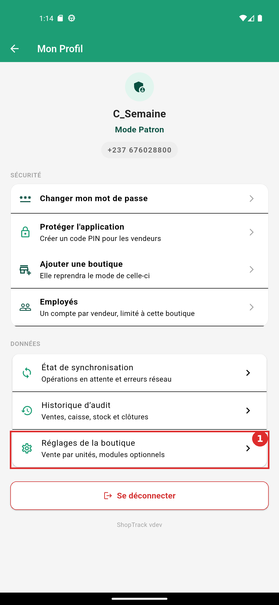
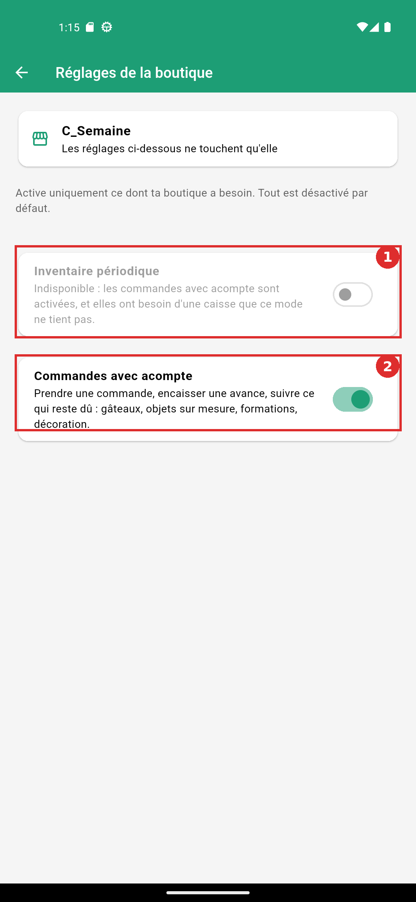
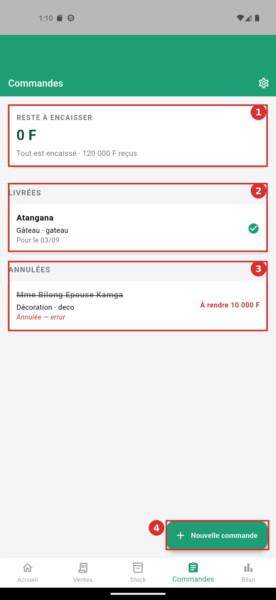
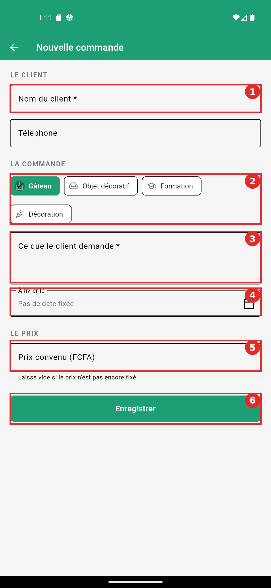

# ShopTrack — Prendre des commandes avec acompte

> Pour les gâteaux, les objets sur mesure, les formations et les décorations.
> Tout ce qu'un client commande d'avance et paie en plusieurs fois.

---

## 1. Allumer le module

Il est **éteint au départ**. Une boutique qui ne prend aucune commande n'a pas
besoin d'un écran de plus.

**Touche le rouage** en haut à droite de n'importe quel écran, puis
**Réglages de la boutique**.



**①** *Réglages de la boutique* — c'est là que vivent les modules.



**②** Une boutique ne peut pas faire **inventaire périodique** *et* commandes en
même temps. Les commandes ont besoin d'une caisse que ce mode ne tient pas.
L'application le dit et bloque le choix, plutôt que de te laisser faire une
erreur.

**③** Allume **Commandes avec acompte**. Un onglet **Commandes** apparaît
aussitôt en bas de l'écran.

> **Ce réglage ne vaut que pour cette boutique.** Si tu en as plusieurs, chacune
> a le sien.

---

## 2. L'écran Commandes



**①** **Reste à encaisser** — la seule question qui compte en ouvrant cet écran :
combien d'argent t'attend encore. Ce n'est **pas** le total des commandes : une
commande de 150 000 F déjà payée n'y est plus.

**②** **À livrer** — le travail qui reste. Les retards remontent en haut, en
rouge, avec le nom de la cliente. Ensuite viennent les dates les plus proches.

**③** **Livrées** puis **Annulées** — l'histoire, gardée. Une commande annulée
n'est jamais effacée : ses acomptes doivent rester visibles.

**④** **Nouvelle commande** — pour enregistrer une demande.

> Sur une commande annulée, l'application écrit **« À rendre 10 000 F »** et non
> « reste à payer ». La cliente ne te doit rien — c'est toi qui gardes son
> argent.

---

## 3. Enregistrer une commande



**①** Le **nom de la cliente**, obligatoire. C'est lui que tu liras partout :
dans la liste, dans le journal de caisse, dans le bilan.

**②** Le **métier** : gâteau, objet décoratif, formation, décoration.

**③** **Ce qu'elle demande**, en une phrase. *« Gâteau 3 étages, vanille, décor
doré, 60 personnes »* vaut mieux que *« gâteau »* — dans trois semaines, tu ne
t'en souviendras plus.

**④** **À livrer le** — c'est cette date qui déclenche l'alerte de retard. Sans
elle, rien ne te préviendra.

**⑤** Le **prix**, si tu le connais déjà. **Laisse vide sinon** : la commande
sera marquée « Prix à fixer » et un bandeau te le rappellera.

**⑥** **Enregistrer** ouvre directement la fiche de la commande — l'acompte se
prend dans la foulée, sans revenir en arrière.

---

## 4. L'argent

Sur la fiche d'une commande, tu peux **encaisser un paiement** à tout moment.

### Espèces ou Mobile Money : ce n'est pas pareil

```
Espèces        →  l'argent entre dans ta caisse tout de suite
Orange Money   →  l'argent est sur ton téléphone, PAS dans ta caisse
MTN MoMo       →  pareil
```

C'est important, et l'application y tient : si elle comptait le Mobile Money
dans ta caisse, tu trouverais **un manquant du même montant** chaque soir en
comptant tes billets — et tu chercherais qui a pris l'argent.

Une carte orange **« PAS ENCORE DANS LA CAISSE »** apparaît sur l'écran
Commandes dès qu'il y a du Mobile Money non retiré, avec le détail par moyen.

**Quand tu vas retirer chez l'agent**, touche cette carte et saisis ce que tu as
retiré. **C'est à ce moment-là** que ta caisse monte.

### Rembourser

Un remboursement est **une ligne de plus**, jamais une suppression. L'acompte
encaissé reste visible. L'histoire de ton argent ne se réécrit pas.

---

## 5. Livrer

Quand la commande part, touche **Marquer comme livrée**.

L'application te demande alors **ce que ça t'a coûté** : ingrédients, matière,
ce que tu as payé à quelqu'un.

> **N'y mets pas ce que tu vas resservir.** Une arche, des vases, une tenture ne
> sont pas un coût de cette commande — ils resserviront trente fois.

Tu peux **passer** et le mettre plus tard : tu ne connais pas toujours ton coût
le jour de la livraison. Un bandeau orange restera sur la fiche, et le titre de
la section dira **« LIVRÉES — 1 sans coût »** jusqu'à ce que ce soit fait.

Dès que le coût est saisi, la fiche affiche **« J'ai gagné … »**.

### Une commande livrée est finie

Plus de correction de prix, plus d'annulation. Corriger un prix des semaines
plus tard ferait changer tout seul un bilan que tu as déjà consulté.

Seul **encaisser** reste possible : une cliente peut emporter sa commande en
devant encore de l'argent.

---

## 6. Qui fait quoi

| | La vendeuse | La patronne |
|---|---|---|
| Enregistrer une demande | ✅ | ✅ |
| Fixer le prix d'un gâteau, d'un objet, d'une formation | ✅ | ✅ |
| Fixer le prix d'une **décoration** | ❌ | ✅ |
| Encaisser, rembourser avant livraison | ✅ | ✅ |
| Corriger le nom, la date, la description | ✅ | ✅ |
| Marquer livrée | ✅ | ✅ |
| Dire **ce que ça a coûté** | ❌ | ✅ |
| Voir le **bénéfice** | ❌ | ✅ |
| **Annuler** une commande | ❌ | ✅ |
| Rembourser **après** livraison | ❌ | ✅ |

**Pourquoi la décoration est à part** : un gâteau et une formation ont un tarif
connu d'avance. Une décoration se chiffre au cas par cas — la salle, le nombre
d'invités, ce qu'il faut louer. C'est un devis, pas un prix.

**Pourquoi la vendeuse ne voit pas le coût** : c'est le chiffre qui dit ce que
tu gagnes sur chaque commande.

---

## 7. Le bilan

Onglet **Bilan**, réservé à la patronne. Deux parties séparées, jamais
additionnées :

**BOUTIQUE** — ce que le comptoir a vendu.

**COMMANDES** — ce que les commandes ont rapporté :

```
Chiffre d'affaires    seulement les commandes LIVRÉES ce mois
Ce que ça a coûté
Bénéfice
Encore dû             avec le nom de chaque cliente
```

Un acompte n'est **pas** un bénéfice. Tant qu'une commande n'est pas livrée,
elle ne compte pas — c'est de l'argent avancé, pas gagné.

Et si des commandes livrées n'ont pas leur coût, le bilan le dit :
**« le bénéfice affiché est plus beau que le vrai »**. Mieux vaut le savoir que
décider sur un chiffre incomplet.

Le bouton en haut à droite génère un **PDF** — pour l'envoyer, l'imprimer, ou le
garder.
